# DSO202 Assignment 3: Package and Configuration Management with Kustomize and Helm

**Name:** ____________________
**Student ID:** ____________________
**Course:** DSO202
**Date:** 5 November 2026

---

## 1. Introduction

Modern applications are rarely deployed just once. The same application usually runs in several environments, such as development, testing and production, and each one needs slightly different settings: the number of replicas, resource limits, log levels, domain names and credentials. Managing these differences is one of the everyday challenges of running software on Kubernetes.

The simplest approach is to keep a separate copy of the YAML files for every environment. This works at first, but it does not scale. Every change must be repeated in each copy, and over time the copies stop matching each other. This problem is called **configuration drift**, and it leads to errors that appear in one environment but not in another.

Two widely used tools address this problem in different ways:

- **Kustomize** keeps one shared **base** of plain YAML and adds small **overlays** that describe only what is different for each environment. It is built into `kubectl`.
- **Helm** is a package manager for Kubernetes. It bundles an application as a **chart** (a template package), takes the settings from a **values file** per environment, and tracks every install as a named **release** with a revision history.

In this assignment I use both tools to deploy the same multi-tier application (a PostgreSQL database run as a StatefulSet with persistent storage, a backend, a frontend, and an NGINX Ingress) in a **dev** and a **prod** environment. This lets me compare how each tool handles configuration, environment differences, updates and rollbacks.

---

## 2. Objectives

1. Re-create the Assignment 2 application (StatefulSet database, backend, frontend, Ingress, quota) using Kustomize.
2. Make a **dev** and a **prod** version using overlays.
3. Re-create the same application as a Helm chart with separate values for dev and prod.
4. Test that the database data survives when the StatefulSet is deleted.
5. Show Helm features: lint, template, install, test, upgrade, history and rollback.
6. Explain the differences between the two tools.

---

## 3. Environment and Tools

| Item | Value |
|---|---|
| Cluster | kind cluster with 1 control-plane and 2 worker nodes |
| Kubernetes version | v1.36.1 |
| kubectl | v1.32.2 (with built-in Kustomize v5.5.0) |
| Helm | v3.18.6 |
| Ingress controller | ingress-nginx (installed in Assignment 2) |
| Operating system | Windows (PowerShell) |

---

## 4. Project Structure

```
DSO202_ASSIGNMENT_2_Kustomize_Helm/
├── kustomize/
│   ├── base/                  # shared by every environment
│   │   ├── kustomization.yaml # resource list + config/secret generators
│   │   ├── app.env            # config values (generator source)
│   │   ├── secret.env         # dummy credentials (generator source)
│   │   ├── database/          # StatefulSet + headless service
│   │   ├── backend/           # Deployment + Service
│   │   ├── frontend/          # Deployment + Service + Ingress
│   │   └── quota.yaml         # ResourceQuota + LimitRange
│   └── overlays/
│       ├── dev/               # only the differences for dev
│       └── prod/              # only the differences for prod
├── helm/
│   ├── dso202-app/            # the chart (Chart.yaml, values.yaml, templates/)
│   └── environments/          # dev.yaml and prod.yaml (values per environment)
├── assignment-2/              # my original plain-YAML work
├── evidence/                  # screenshots for this report
└── README.md
```

---

## 5. Design

### 5.1 The application

| Part | Kubernetes object | Notes |
|---|---|---|
| Database | StatefulSet `db` + headless Service `db-svc` | 1 replica, 1Gi PVC, PVC is **kept** when the StatefulSet is deleted |
| Backend | Deployment `backend-deployment` + Service `backend-svc` | port 8080, readiness probe on `/api/status` |
| Frontend | Deployment `frontend-deployment` + Service `frontend-svc` | port 8080 |
| Entry point | Ingress `frontend-ingress` | `/api` goes to the backend, `/` goes to the frontend |
| Limits | ResourceQuota + LimitRange | different pod limits for dev and prod |
| Settings | ConfigMap `app-config`, Secret `app-secret` | passwords in this lab are **dummy values** |

### 5.2 Kustomize design

- **Base** holds everything shared. It has no namespace, so it can be used anywhere.
- **Overlays** hold only the differences: namespace, labels, replica counts, image tags, config changes and patches.
- Instead of writing a ConfigMap and Secret by hand, I use **generators** (`configMapGenerator`, `secretGenerator`). Kustomize adds a hash to the name (for example `app-config-tf6fh5c4hk`) and updates every place that uses it. When the config changes, the name changes, so the pods restart automatically.
- Labels use `includeSelectors: false`. This adds labels to every object **without** changing selectors, because selectors on Deployments and StatefulSets cannot be changed after creation.
- Two types of patches are used:
  - **Strategic merge patch** (prod resources and quota): I write the part of the Kubernetes YAML I want to change.
  - **JSON 6902 patch** (Ingress host): I point to an exact path, for example `/spec/rules/0/host`.

### 5.3 Helm design

- `Chart.yaml` describes the package (name, chart version, app version).
- `values.yaml` has the default settings. `environments/dev.yaml` and `environments/prod.yaml` override only what is different.
- `templates/` has one template per object. Values are filled in with `{{ .Values... }}`.
- `values.schema.json` checks the input values before installing.
- The database password has **no default**. The `required` function stops the install if it is missing, so the real password is never stored in Git.
- `checksum/config` and `checksum/secret` annotations on the pods make them restart when the ConfigMap or Secret changes. This is Helm's version of the Kustomize hash.
- A **helm test** pod calls `/api/status` and checks that the answer contains `"db":"connected"`.

### 5.4 Differences between dev and prod

| Setting | Dev | Prod |
|---|---|---|
| Namespace | `dso202-assignment-02-dev` | `dso202-assignment-02-prod` |
| Backend / frontend replicas | 1 / 1 | 2 / 2 |
| Database replicas | 1 | 1 |
| `LOG_LEVEL` | `debug` | `warn` |
| Ingress host | `dev.dso202.example.local` | `dso202.example.local` |
| `proxy-body-size` | 1m | 8m |
| Quota (pods) | 10 | 15 |
| Backend resources | 100m CPU / 128Mi | 200m CPU / 128Mi (limit 500m) |

---

## 6. Implementation

The work was done in five stages: (1) prepare the environment, (2) build and test Kustomize for dev, (3) build and test Kustomize for prod, (4) build and test the Helm chart, and (5) verify everything. Every stage was checked before the next one started. The screenshots in each step are the evidence.

### 6.1 Preparing the environment

I opened PowerShell in the project folder and checked the tools and the cluster:

```powershell
kubectl version --client
helm version
kubectl get nodes
kubectl get pods -n ingress-nginx
```

All three nodes were `Ready` and the ingress controller was `Running`. I then copied my Assignment 2 files into `assignment-2/` and used the same container images (`rynorbu11/dso202-backend:1.0`, `dso202-frontend:1.0`, `dso202-db:1.0`) in both the Kustomize base and the Helm `values.yaml`, so that all versions run the same application.

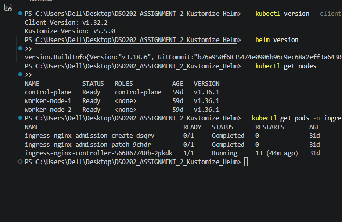

### 6.2 Building the Kustomize base

The base contains the YAML that is the same in every environment. I split the Assignment 2 files into folders by tier (`database/`, `backend/`, `frontend/`) and added `quota.yaml`. The base has **no namespace**, so any overlay can place it where it wants.

Instead of hand-written ConfigMap and Secret files, `kustomization.yaml` uses generators that read plain `.env` files:

```yaml
resources:
  - database/statefulset.yaml
  - database/service.yaml
  - backend/deployment.yaml
  - backend/service.yaml
  - frontend/deployment.yaml
  - frontend/service.yaml
  - frontend/ingress.yaml
  - quota.yaml

configMapGenerator:
  - name: app-config
    envs:
      - app.env

secretGenerator:
  - name: app-secret
    envs:
      - secret.env
```

Kustomize adds a content hash to the generated names (for example `app-config-tf6fh5c4hk`) and rewrites every reference to them. Because of this, a config change creates a new name and makes the pods roll out automatically. The database StatefulSet also sets `persistentVolumeClaimRetentionPolicy: Retain`, so its PVC is kept when the StatefulSet is deleted.

### 6.3 Kustomize dev overlay

The dev overlay points to the base and contains only what is different:

```yaml
resources:
  - ../../base
  - namespace.yaml

namespace: dso202-assignment-02-dev

labels:
  - pairs:
      app.kubernetes.io/environment: dev
      debug: "true"
    includeSelectors: false

patches:
  - target:
      kind: Ingress
      name: frontend-ingress
    patch: |-
      - op: add
        path: /spec/rules/0/host
        value: dev.dso202.example.local
```

- `namespace:` moves every object into the dev namespace.
- `includeSelectors: false` adds the labels to every object **without** touching selectors.
- The **JSON 6902 patch** sets the Ingress host by exact path. I needed it because of the Ingress conflict described in Section 7 (Problem 1).

**Render.** `kubectl kustomize kustomize/overlays/dev` shows the final YAML. I checked that:

- the ConfigMap is named `app-config-tf6fh5c4hk` and the Deployments and StatefulSet use this hashed name,
- every object is in the namespace `dso202-assignment-02-dev`,
- labels `app.kubernetes.io/environment: dev` and `debug: "true"` were added to every object.

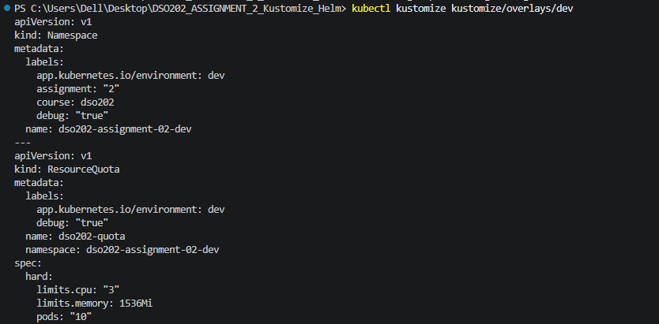
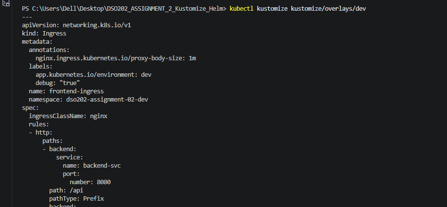

**Apply.** I applied the overlay and checked the status:

```powershell
kubectl apply -k kustomize/overlays/dev
kubectl get statefulset,pods,pvc,ingress -n dso202-assignment-02-dev
```

All objects were created except the Ingress (see Problem 1). After adding the JSON 6902 patch with the dev host, the Ingress was created.

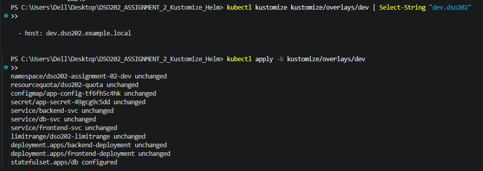
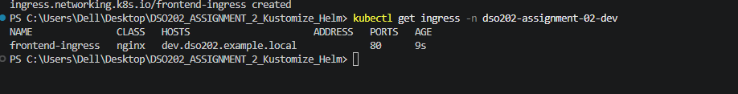

### 6.4 Testing through the Ingress (dev)

I forwarded the ingress controller port in one terminal and sent the request in a second one:

```powershell
kubectl -n ingress-nginx port-forward svc/ingress-nginx-controller 8088:80
curl.exe -H "Host: dev.dso202.example.local" http://localhost:8088/api/status
```

I used `curl.exe` because `curl` in PowerShell is an alias for `Invoke-WebRequest` and does not accept `-H`. The answer `{"status":"ok","db":"connected"}` proved that Ingress, backend and database worked together.

Terminal 1 (port-forward):

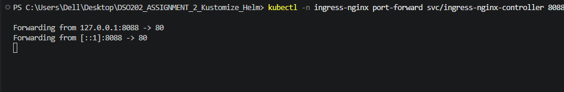
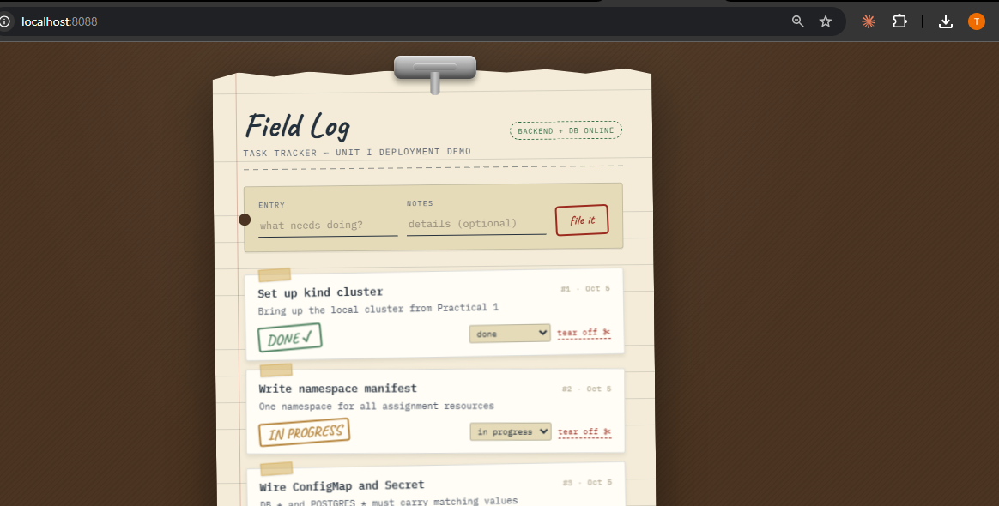

Terminal 2 (curl):

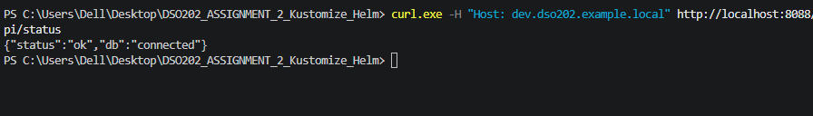

### 6.5 Persistence test (dev)

The goal is to prove that the data lives in the PVC, not inside the pod.

1. I created a task in the application.

   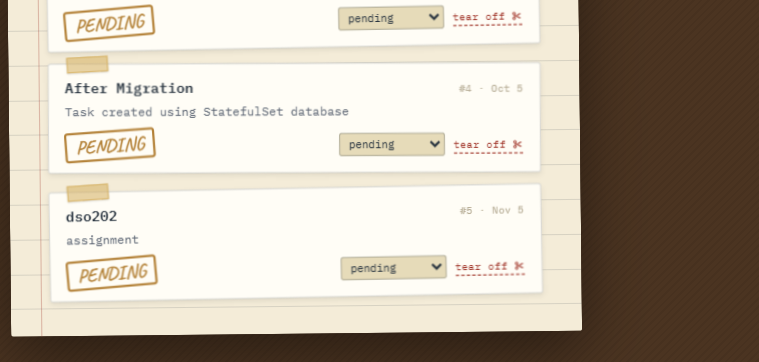

2. I deleted **only the StatefulSet** and checked the PVC. `data-db-0` stayed `Bound`, because the StatefulSet has `persistentVolumeClaimRetentionPolicy: Retain`.

   ```powershell
   kubectl delete statefulset db -n dso202-assignment-02-dev
   kubectl get pvc -n dso202-assignment-02-dev
   ```

   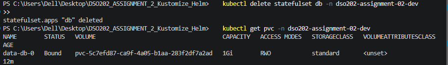

3. I applied the overlay again. The StatefulSet was created again and became ready.

   ```powershell
   kubectl apply -k kustomize/overlays/dev
   ```

   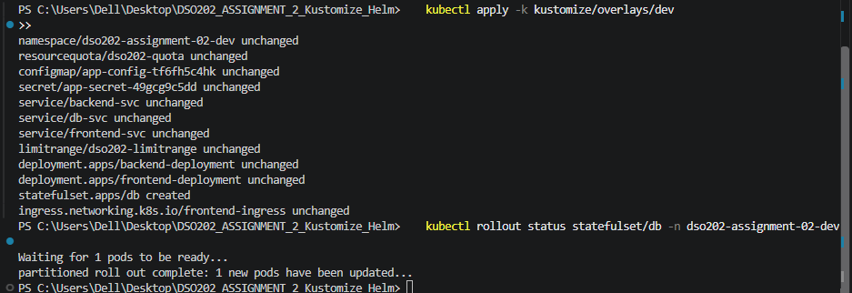

4. I read the tasks back. The task was still there, so the data survived.

   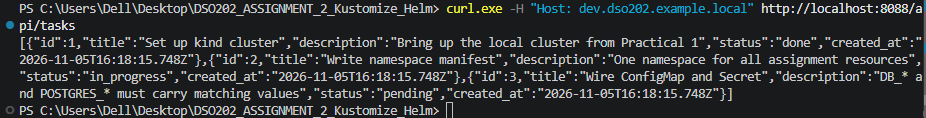

### 6.6 Kustomize prod overlay

The prod overlay has the same structure as dev, with these differences:

- namespace `dso202-assignment-02-prod`
- a **strategic merge patch** that sets 2 replicas for the backend and frontend and raises the backend resources
- a strategic merge patch on the quota (pods `15`, higher CPU and memory)
- a JSON 6902 patch for host `dso202.example.local` and the annotation `proxy-body-size: 8m`
- a config override that sets `LOG_LEVEL=warn`, which also gives a different ConfigMap hash (`app-config-dg6d9d6kk6`)

I used both patch types on purpose: strategic merge for larger changes where I can write the Kubernetes fragment, and JSON 6902 for one exact field.

**Render.** The prod render shows all the differences from dev:

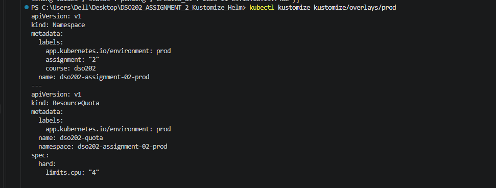
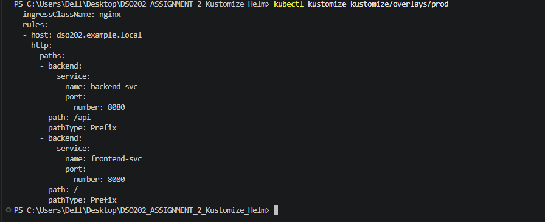

**Apply.** I created the prod namespace and applied the overlay. All pods became `1/1 Running` (2 backend, 2 frontend, 1 database) and the prod PVC was `Bound`.

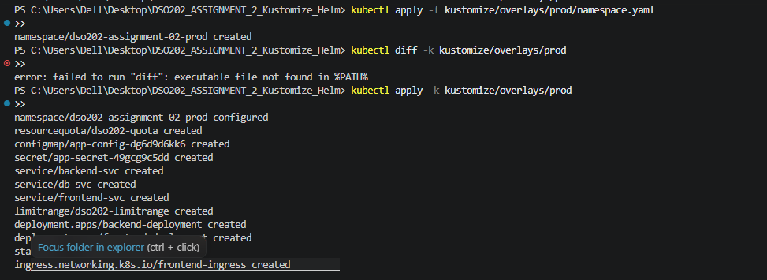
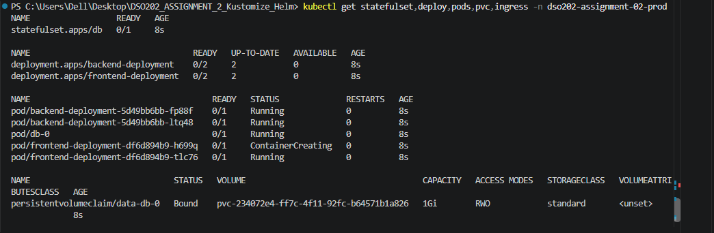
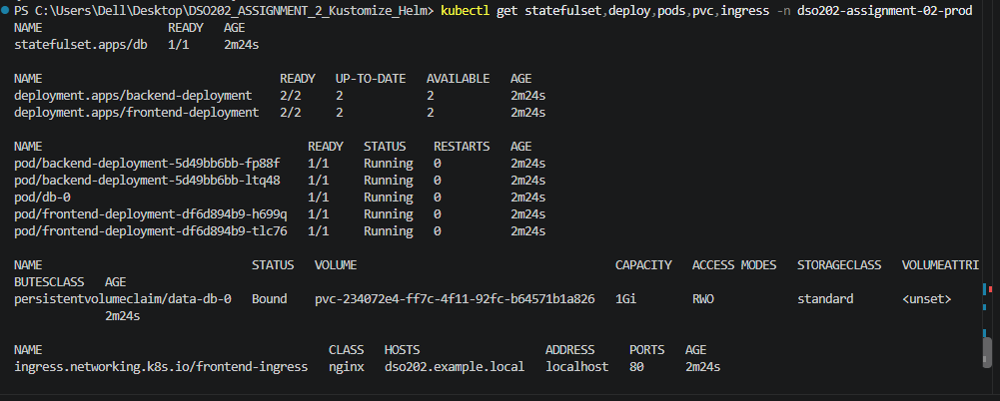

**Test.** The request with the prod host name returned `"db":"connected"`.

```powershell
curl.exe -H "Host: dso202.example.local" http://localhost:8088/api/status
```

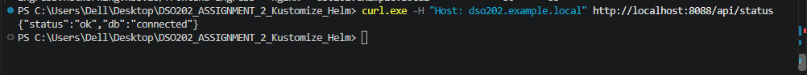

**Comparing dev and prod.** `kubectl diff` did not work on my Windows computer (see Problem 3), so I rendered both overlays to files and compared them with `Compare-Object`. The result shows only the differences listed in Section 5.4, which proves that the overlays contain only what is different.

### 6.7 Building the Helm chart

The Helm chart `helm/dso202-app/` turns the same application into templates:

- `Chart.yaml` holds the chart name, chart version and app version.
- `values.yaml` holds the defaults (images, ports, replicas, resources, config, ingress, quota).
- `templates/` has one file per object (StatefulSet, Deployments, Services, Ingress, ConfigMap, Secret, quota, test pod). Values are inserted with `{{ .Values... }}`.
- `values.schema.json` validates the values before an install.
- `environments/dev.yaml` and `environments/prod.yaml` override only what is different, for example replicas, `LOG_LEVEL`, host and quota.

Two features are important:

1. **Required password.** The Secret template uses `required`, so the install fails if no password is given. This keeps the real prod password out of Git:

   ```yaml
   POSTGRES_PASSWORD: {{ required "secret.dbPassword is required" .Values.secret.dbPassword | b64enc }}
   ```

2. **Restart on change.** The pod templates carry checksum annotations of the ConfigMap and Secret. When the content changes, the annotation changes and the pods restart:

   ```yaml
   annotations:
     checksum/config: {{ include (print $.Template.BasePath "/configmap.yaml") . | sha256sum }}
   ```

I also added a **helm test** pod that calls `/api/status` and checks that the answer contains `"db":"connected"`.

### 6.8 Helm clean-up and dev host

Before installing with Helm, I deleted the Kustomize objects and their namespaces, because Helm does not take over objects that it did not create.

```powershell
kubectl delete -k kustomize/overlays/prod
kubectl delete -k kustomize/overlays/dev
```

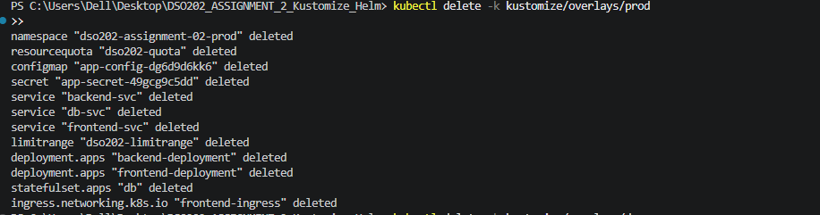
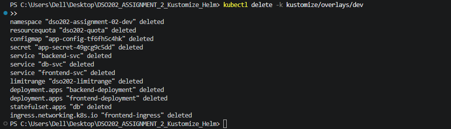
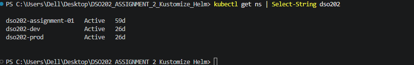

I also added the host `dev.dso202.example.local` to `helm/environments/dev.yaml`, to avoid the same Ingress conflict.

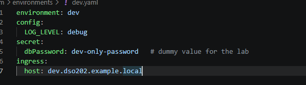

### 6.9 Helm lint, template, install and test (dev)

```powershell
helm lint helm/dso202-app -f helm/environments/dev.yaml
helm template dso202 helm/dso202-app -n dso202-assignment-02-dev -f helm/environments/dev.yaml
helm upgrade --install dso202 helm/dso202-app -n dso202-assignment-02-dev `
  --create-namespace -f helm/environments/dev.yaml --wait --timeout 3m
helm test dso202 -n dso202-assignment-02-dev
```

- `helm lint` reported no errors (only an info message that an icon is recommended).
- `helm template` printed all objects with the dev values: `LOG_LEVEL: debug`, 1 replica, host `dev.dso202.example.local`, and the `checksum/*` annotations.

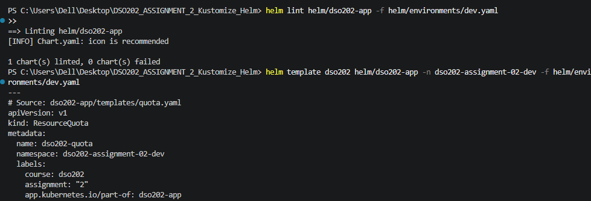
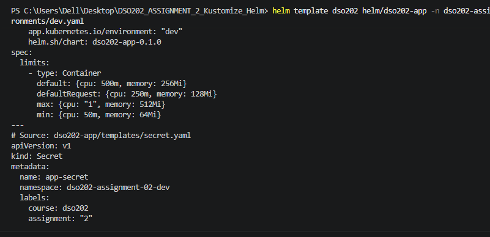

- `helm upgrade --install --wait` installed release `dso202` (revision 1, status `deployed`).
- `helm test` ran the test pod and its phase was `Succeeded`.
- The request through the Ingress returned `"db":"connected"`.

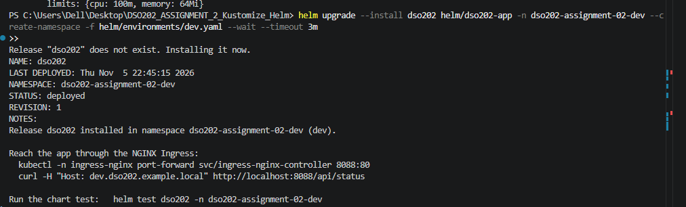
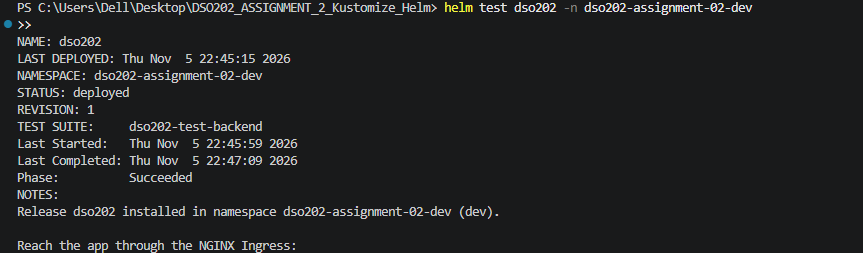
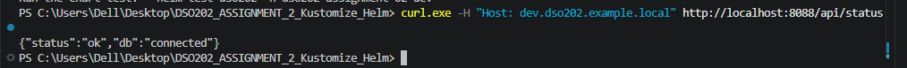

### 6.10 Helm upgrade, history and rollback

To show release management, I upgraded the release and rolled it back:

```powershell
helm upgrade dso202 helm/dso202-app -n dso202-assignment-02-dev `
  -f helm/environments/dev.yaml --set config.LOG_LEVEL=info
helm history dso202 -n dso202-assignment-02-dev
helm rollback dso202 1 -n dso202-assignment-02-dev
```

Helm did not go "back" to revision 1; it created a **new revision 3** with the content of revision 1.

| Revision | Status | Description |
|---|---|---|
| 1 | superseded | Install complete |
| 2 | superseded | Upgrade complete |
| 3 | deployed | Rollback to 1 |

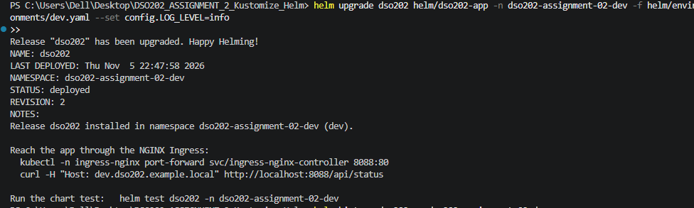
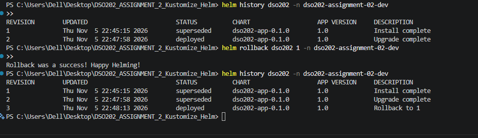

After the rollback, the ConfigMap shows `LOG_LEVEL` = `debug` again (not `info` from revision 2). This proves that the rollback really reverted the release.

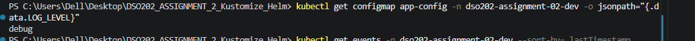

### 6.11 Helm prod

For prod I used `helm/environments/prod.yaml` and passed the password on the command line, because it is not stored in Git:

```powershell
helm upgrade --install dso202-prod helm/dso202-app -n dso202-assignment-02-prod `
  --create-namespace -f helm/environments/prod.yaml `
  --set secret.dbPassword=<password> --wait --timeout 3m
```

The install worked and the request with the prod host returned `"db":"connected"`.

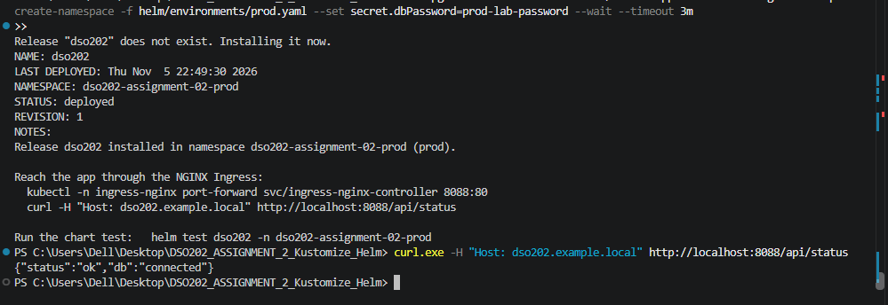

### 6.12 Final verification

`helm list -A` shows both releases (dev at revision 3, prod at revision 1). The prod pods were all `1/1 Running`, the PVC was `Bound`, and `helm test` for prod also `Succeeded`.

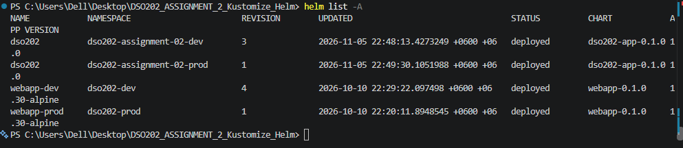
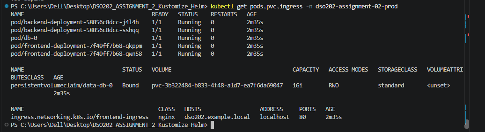
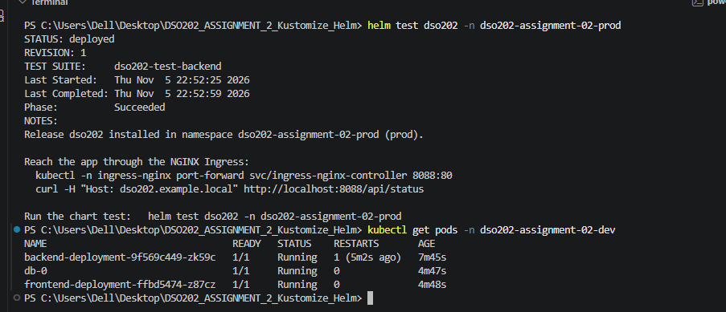

After the config changes, Helm replaced the dev pods, because the `checksum/config` annotation changed. The backend shows 1 restart. This is most likely because the backend started before the database was ready and then recovered. Everything ended as `1/1 Running`.

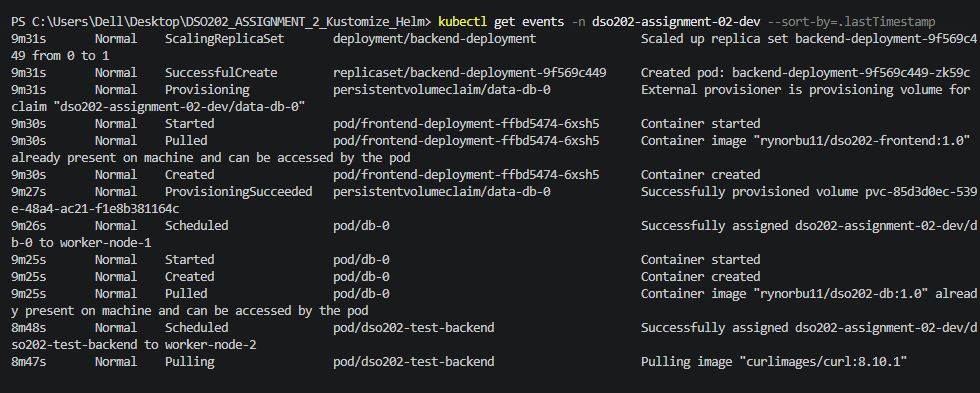
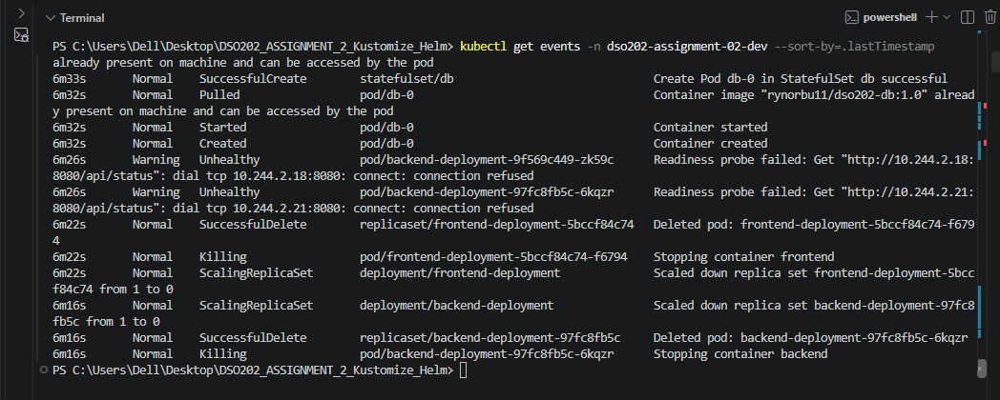

---

## 7. Problems and How I Fixed Them

| # | Problem | Cause | Fix |
|---|---|---|---|
| 1 | The Ingress was rejected: `host "_" and path "/api" is already defined in ingress dso202-assignment-01/frontend-ingress` | The Ingress from Assignment 1 already used "any host" with `/api`, and the ingress controller does not allow two Ingresses to claim the same host and path | Gave dev its own host (`dev.dso202.example.local`) with a JSON 6902 patch in Kustomize and a value in Helm |
| 2 | `kubectl diff` said the namespace was not found | The namespace did not exist yet, so the dry run failed | Created the namespace first with `kubectl apply -f .../namespace.yaml` |
| 3 | `kubectl diff` said `executable file not found` | Windows has no `diff` program, and the path with a space (`Program Files`) could not be used | Rendered dev and prod to files and compared them with PowerShell `Compare-Object` |
| 4 | `curl` in PowerShell does not accept the usual `-H` option | In PowerShell, `curl` is an alias for `Invoke-WebRequest` | Used `curl.exe` |
| 5 | Backend restarted once after the first start | It started before the database was ready | No fix needed. The readiness probe and the automatic restart handled it |

The main lesson from Problem 1: when several environments share one ingress controller, each environment needs its own host name.

---

## 8. Discussion

### 8.1 Configuration drift
With plain YAML I would need a copy of every file for dev and a copy for prod. With Kustomize, shared settings (for example a readiness probe) are written **once** in the base. With Helm, they are written once in the template. Only real differences are written per environment.

### 8.2 Automatic restart when config changes
Pods do not restart by themselves when a ConfigMap changes. Kustomize solves this with a hash in the generated name: new content gives a new name, so the pod template changes and the pods roll. Helm solves this with the `checksum/config` annotation, which changes when the content changes. In my test the Helm pods were replaced after the config changes.

### 8.3 Kustomize compared with Helm

| Point | Kustomize | Helm |
|---|---|---|
| Idea | Patch plain YAML | Render templates with values |
| Input | Base + overlays | Chart + values files |
| History | None. To go back, revert in Git | Numbered revisions, `helm rollback` |
| Built into kubectl | Yes (`kubectl apply -k`) | No, separate tool |
| Validation | Only Kubernetes validation | `values.schema.json`, `required`, `helm lint` |
| Testing | Not built in | `helm test` |
| Learning curve | Easier, no template language | Harder, needs Go template syntax |
| Best for | Small differences between environments | Packaging and sharing an app with many options |

Strategic merge and JSON 6902 patches also differ: strategic merge "speaks Kubernetes" (I write the fragment I want), and JSON 6902 "speaks paths" (I give an exact path and an operation).

### 8.4 Security
- Kubernetes Secrets are only **base64 encoded**, not encrypted. Anyone who can read the Secret can decode it.
- The passwords in this lab are dummy values (`change-me`, `dev-only-password`, `prod-lab-password`). Real passwords must never be committed to Git.
- Helm stores the values used for a release inside its own release Secret. In a real system, passwords should come from a secret manager.
- In Helm, the prod password is passed on the command line and is not stored in the chart or in Git.

### 8.5 Limits of this design
- A StatefulSet with **one** database replica gives a stable name and stable storage, but it is **not** high availability. If the pod stops, the database is unavailable until it comes back. Real replication needs extra tools.
- The `checksum/*` annotations are also on the database pod, so a config change restarts the database too. The data stays safe because of the PVC, but in a real system this might be avoided.
- Both tools must not manage the same objects in the same namespace. I deleted the Kustomize objects before installing with Helm.

---

## 9. Conclusion

I recreated the Assignment 2 application (StatefulSet database with persistent storage, backend, frontend and NGINX Ingress) with both Kustomize and Helm. Each version works in a **dev** and a **prod** environment, and each one answered `"db":"connected"` through the Ingress.

- With **Kustomize**, one base and two small overlays were enough. The generators gave hashed names and automatic restarts, and the two patch types changed prod resources, quota and the Ingress host. The persistence test proved the data survives when the StatefulSet is deleted.
- With **Helm**, one chart and two values files gave the same result, plus validation, a test pod, and a revision history with upgrade and rollback.

The main problem was the Ingress host conflict with the old Assignment 1 Ingress. It showed me that every environment on a shared ingress controller needs its own host. I also learned how to work around Windows limits (`kubectl diff` and `curl`).

Kustomize is simpler and good for small differences between environments. Helm is better when I need packaging, validation, tests and rollback history.

